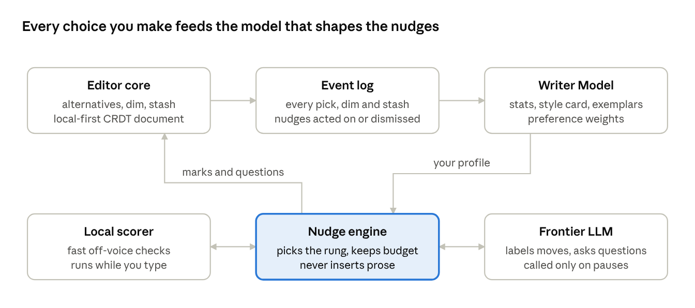
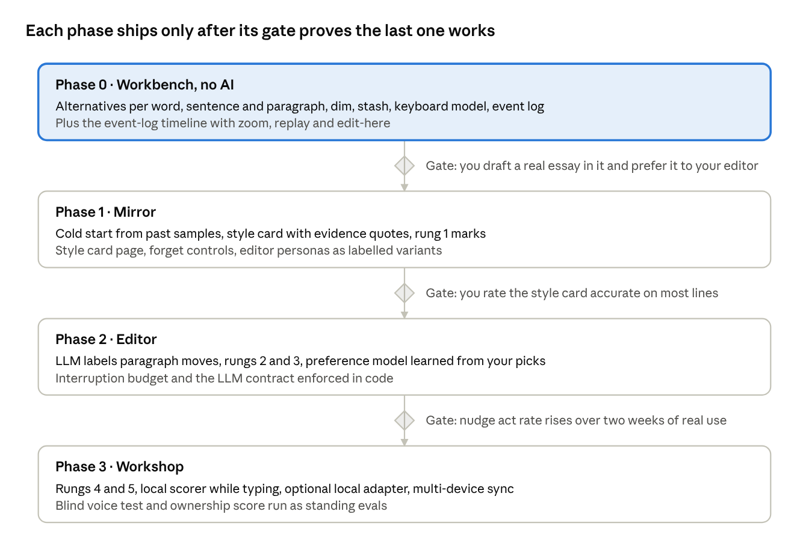

# Write\_On Thought Partner: Master Spec & Research

Nov 10, 2026 · tp53 · exported 2026-11-10-1731UTC · live, editable version: https://claude.ai/artifact/A9AkRirCKozPjctQpqhN7P

Write\_On is an editor where every word, sentence and paragraph can hold quiet alternatives, and a thought partner that learns how you think on the page and nudges without ever writing the piece for you. This doc specs both layers, from the Write\_On core we reproduce to the learning layer we add on top.

## How to read this doc

Every claim about Jason Fried's original carries a grounding tag, so we never confuse what he built with what we imagine.

| Tag | Meaning | Example |
| --- | --- | --- |
| \[TWEET\] | Stated in the launch post text | "alternative control at the word, sentence, and paragraph level" |
| \[CLIPS\] | Measured from the three demo clips by the open-source replica's author | Ghosted text sits at about 11% opacity |
| \[CLONE\] | A clone's own design decision where the clips are silent | Alternative groups do not nest |
| \[VIDEO\] | Checked by us against our own download of the video | Pending: the video is still being pulled to your laptop |
| \[INFERRED\] | Our reading of how it likely works | Why a flip is not an undo step |
| \[NEW\] | Our extension beyond Write\_On | The style model and the nudge system |

Status today: the Write\_On teardown is drafted from the clips as measured by two open-source clones, and the landscape section from the research thread's notes. Our own \[VIDEO\] check is pending. Everything in sections on the learning layer, nudges, imitation and evaluation is \[NEW\] by definition.

## Vision and thesis

The product is a thought partner, not a ghostwriter: it makes you a better and faster version of yourself, and it never produces the piece. Writing is thinking made visible, so a tool that writes for you thinks for you, and that is the one thing we refuse to do.

**The one-sentence thesis.** Write\_On keeps every option you considered within reach, learns which options you tend to choose and why, and uses that knowledge to ask better questions, not to supply answers.

**Three roles it plays, in order of how often.**

1. **The workbench** (Write\_On core). A place to play with phrasing: try three versions of a sentence, dim a paragraph you are unsure about, stash a line you love but can't use yet. Zero AI required. \[TWEET\]
2. **The attentive editor** (learning layer). It has read everything you've written and notices when you drift from your own voice, repeat a tic, bury the lede, or leave a claim unsupported. It points; you fix. \[NEW\]
3. **The sparring partner** (on request). When you're stuck, it asks a question, offers a counterargument, or shows how you opened similar paragraphs in the past. It hands you a lever, never the finished sentence. \[NEW\]

**A concrete picture.** You type: "The meeting was really very productive and we made a lot of progress." A ghostwriter rewrites it. Write\_On instead does three small things: it lets you hold "The meeting moved us forward" as an alternative under the same sentence; it underlines "really very" faintly because you cut intensifiers in most of your past drafts; and if you ask, it says "What was the progress? Your best paragraphs name the specific thing." You still write the sentence.

**An alternative framing.** Think of a chess engine used for training, not for playing. Good coaches turn off the "best move" arrow and turn on "this move loses a piece, look again." Write\_On is the coach mode: it evaluates and prompts, and the human makes every move.

## Design principles and anti-goals

Ten rules settle most product arguments before they start. When a feature idea conflicts with one, the rule wins unless we rewrite the rule on purpose.

| # | Principle | What it means in practice | Violation looks like |
| --- | --- | --- | --- |
| 1 | The human writes every sentence that ships | The AI may never insert prose into the canonical text without an explicit, per-instance accept | "Continue writing" button that fills a paragraph |
| 2 | Nothing is ever lost | Every alternative, dimmed span and stashed fragment is kept and recoverable | Overwriting a sentence when you pick a new variant |
| 3 | Alternatives, not versions | Options live beside the text, at the grain you're thinking in, not as whole-document snapshots \[TWEET\] | A git-style history panel as the main tool |
| 4 | Quiet by default | The editor is silent unless invited, or unless a signal is strong and personal | Red squiggles on every passive verb |
| 5 | Point, don't fix | Nudges name the issue and where; the writer does the rewrite | A suggestion card with a one-click replacement paragraph |
| 6 | Personal over generic | Advice is grounded in *your* corpus ("you usually...") before general rules | "Avoid adverbs" for a writer whose voice relies on them |
| 7 | Explain every nudge | Each nudge shows why it fired and the evidence from your own writing | A mysterious score with no breakdown |
| 8 | Your model is yours | The style profile is inspectable, editable, exportable and deletable | A hidden embedding you can't see or correct |
| 9 | Keyboard first, flow first | Every core action is one keystroke and never steals focus | Modal dialogs mid-sentence |
| 10 | Learn from choices, not just text | What you accept, reject, dim and stash teaches more than finished prose | Training only on final published pieces |

**Anti-goals, stated bluntly.** No draft generation from a prompt. No "make this sound better" rewrite of a whole paragraph. No grammar-police mode as the default. No engagement tricks such as streaks or scores. No sending your writing to train anyone else's model.

**The gray zone, and how we decide.** Some help sits on the line, such as offering three synonyms for one word. The test is *grain and agency*: help below the sentence level that you pick from (a word, a connective) is allowed; help at or above the sentence level arrives as a question, a pattern from your own past, or an example from someone else, never as drop-in text. A user can loosen this per document (see the intensity dial in the nudge section), but the default is strict.

## Reverse engineering Write\_On from the demo clips

Write\_On, as shown, is a dark, monospace, single-document editor with five ideas on a bare page: alternatives in place, ghosting, an Overflow side panel, an AI Lab that marks and trims but never rewrites, and one Markdown file that holds it all. This teardown comes from the frame-by-frame measurements published by an open-source replica, cross-checked against a second clone; our own frames will confirm or correct it.

**Grounding for this section.** Fried's post (2026-09-30, decoded from the post ID) has three clips: a 6:55 main walkthrough, a 1:26 follow-up ("Plus more explosions!"), and a 0:52 reply about the file format, all recorded at 3096×1952, 60 fps ([write-on-replica design spec](https://github.com/joeysim/write-on-replica/blob/main/docs/superpowers/specs/2026-10-11-write-on-replica-design.md)). Items below tagged \[CLIPS\] were measured from those clips by the replica's author; items tagged \[CLONE\] are that author's or [undertext](https://github.com/klipstack/undertext)'s design decisions where the clips are silent. Our own \[VIDEO\] check is pending the download on your laptop. Items tagged \[FRIED\] quote Fried's own notes from the post's thread, which confirm the replica's measurements.

### What you see on screen \[CLIPS\]

- **The page.** Near-black navy background (#050a1c), warm peach text (#f5d1c0), IBM Plex Mono at 20 px, a centered 780 px column (65 characters). Text dissolves near the top and bottom edges instead of hitting the chrome.
- **Read mode first.** It opens as just text and a word count ("535 words 3115 chars") in the top left. Clicking the word count (Ctrl+Shift+R) brings in all the tools at once.
- **Chrome, top row.** Word count left; an alternates toggle (three dots over a bar) and an "M↓" source-view icon at center; a keyboard-shortcuts icon at right.
- **Chrome, bottom row.** Save, Open, Post to X and a LinkedIn icon at bottom left (the LinkedIn button is a joke: it dodges the pointer six times and explodes on the seventh); a dashed "LAB" button at bottom center; an "XYZ" Overflow toggle at bottom right.
- **Handwritten labels.** Panel tabs and headers ("Word · Sentence · Paragraph", "Overflow") are set in Caveat, a handwriting font, against the monospace body.

### Alternatives: how they look and move \[CLIPS\]

Each grain has its own mark so the three can sit near each other without confusion.

|  | Word | Sentence | Paragraph |
| --- | --- | --- | --- |
| Mark | Thin violet underline | Lower, pinkish underline | Copper bar in the left margin |
| Dots | Under the word, centered | Inline at the sentence's end | Stacked beside the bar |
| Active dot | Filled violet | Filled pink | Filled copper |

- **One dot per variant**, active one filled, the rest hollow rings. So you can see at a glance that a word has 3 options and which one is showing.
- **Lines look hand-drawn**: a slight wobble and tilt, like an editor's pen. Fried \[FRIED\]: "something a little human, a little wavy, imperfect, just slightly... not too much," so it feels different from "your standard straight and perfect computer-generated underline."
- **Cycling in place.** Hover a marked span; it tints. Arrow keys flip to the next or previous version, with a quick blur-and-fade and live reflow of the line. Delete removes the showing version with a small explosion; undo reverses the explosion.
- **Sound.** Each flip plays a tick. The tick drops in pitch when you land back on the version you started from, so your ear knows when you've come home without looking. In Fried's words \[FRIED\]: "One's higher pitched, which you're gonna hear most of the time, and one is a lower pitched sound. The lower pitch sound is a return to the original. This way, I know when I'm back to the original version I was on before I began playing."
- **Flips aren't undo steps.** Which version shows is state, not an edit, so undo doesn't walk back through your browsing.
- **Grammar follows.** In the clip, "like a thumbtack" becomes "like an eraser" when the word flips: the article agrees with the new variant.

### The alternatives panel \[CLIPS\]

Ctrl+Shift+A (or right-click) slides a 280 px panel in from the left. Tabs show the scope (Word, Sentence, Paragraph). Each version is a row you can edit; typing in the empty row creates a new version and the page updates as you type. While the panel is open, the target stays bright, the rest of its paragraph drops to about 66% and other paragraphs to about 36%, so your eye stays on the spot you're working. Footer hint: "return adds · esc closes".

**AI in the panel.** Typing `??` in an empty row asks the AI for options: five for a word, three for a sentence or paragraph. The question marks dance while it thinks; suggestions arrive one by one, marked with a small robot icon. Ctrl+Shift+G does the same from the page. The suggestions are in-context replacements, not a thesaurus.

### Ghost (dim) \[CLIPS\]

Ctrl+/ or "Ghost it" drops the selection to about 11% opacity, instantly, in place. Ghosted text stays editable and still counts in the word count. "Revive it" brings back the whole ghosted run. Ghost is Fried's "dim stuff back".

### Overflow (stash) \[CLIPS\]

A matching 280 px panel on the right, toggled by "XYZ" or Ctrl+Shift+D, headed "Overflow". It's a plain text area. Ctrl+Shift+X moves the selection (or the whole paragraph) out of the page into Overflow; Ctrl+Return or drag-and-drop moves text back into the page. Footer hint: "ctrl+↵ or drag into the page to use". Overflow is Fried's "stash stuff near by".

### The Lab: AI that marks and trims, never rewrites \[CLIPS\]

The dashed LAB button opens a popover with marking passes and trim levels:

```
Fix punctuation and typos
Mark the weakest sentences
Mark sentences that run long
Mark convoluted sentences
Mark words that don't fit the tone
Mark hedges and filler
[ Original ] [ Slight trim ~10% ] [ Tighten more ~20% ] [ Even sharper ~30% ] [ Cut in half ~50% ]
```

Choosing a trim shows a card ("Slight trim · Reading…"), a crimson scan line sweeps down each paragraph, and then the words that would go fade to about 22%. The card reads "535 → 480 words · −10%" and "Faded words would go. Click one to keep it." Clicking a faded passage keeps it. Switching levels is instant because one AI read serves all four. In the clips only the first two levels are shown.

**If the replica's reading holds, Fried's own AI already obeys "point, don't fix".** It marks, fades and deletes, and it never writes new sentences into your piece except the alternatives you explicitly ask for with `??`. Treat this as secondhand for now: the replica's spec says it observed the Lab popover, the trim card and `??` in the clips, but nobody has published frames we can check, the research survey found the AI role disputed between the two clones, and Fried's post text never mentions AI features. Whether these AI features are in the original is the first thing we'll check against our own frames \[VIDEO pending\].

### The file format \[CLIPS, from the 0:52 reply\]

One Markdown file; Fried \[FRIED\]: "it's all Markdown, too. Alternatives, overflow, etc." Other tools see ordinary Markdown as the piece currently reads. Overflow follows a `<!-- overflow -->` line, and the alternatives, which one is active and what is ghosted live in a `<!-- write_on {…} -->` JSON comment at the end. The replica's reconstruction:

```markdown
# Heading

Paragraph text on one line.

<!-- overflow -->

Overflow text, as plain paragraphs.

<!-- write_on {"version":1,"html":"…","groups":{"kswdaew":{"scope":"sentence","variants":["…","…"],"active":0}}} -->
```

### Shortcuts \[CLIPS\]

Write\_On uses Control, even on the Mac.

| Shortcut | Action |
| --- | --- |
| Ctrl+Shift+R | Read mode (tools off/on) |
| Ctrl+Shift+A | Alternatives for selection or word |
| Ctrl+Shift+G | AI alternatives |
| Ctrl+/ | Ghost it / Revive it |
| Ctrl+Shift+X | Stash in Overflow |
| Ctrl+Shift+D | Overflow panel |
| Ctrl+Return (in Overflow) | Use in the page |
| Ctrl+U | Source view (the raw file) |
| Ctrl+S, Ctrl+O | Save, Open |
| Ctrl+Shift+P | Post to X |

### What the clips leave open \[CLONE\]

- **Nesting.** The replica decided groups do not nest: making a sentence group over word groups flattens them. Undertext also keeps it flat. Unknown in the original.
- **Scope from selection.** A whole paragraph selected becomes a paragraph group, whole sentences a sentence group, anything else a word group (short phrases count as "word").
- **Who owns the arrow keys.** The span under the pointer gets the arrows only while the pointer was the last thing you used; typing hands them back to the caret.
- **Release.** In the first clip Fried says he hopes to release it open source and free; as of October 2026 he hadn't ([write-on-replica README](https://github.com/joeysim/write-on-replica)).

### What this changes in our spec

The Write\_On core section below keeps our names (alternate, dim, stash) as concepts but adopts Fried's names in the UI (Alternatives, Ghost, Overflow, Lab), his Control-key shortcuts, his file format, and his Lab's mark-and-trim discipline as the baseline for the nudge system. The parts nobody has built, which are ours to add, are the learning layer and personal nudges.

## The Write\_On core: alternative control, dim, stash

The core is three verbs on three grains: **alternate**, **dim**, **stash**, each working on a word, a sentence or a paragraph. It needs no AI and is the first thing we build, because the learning layer feeds on the choices these verbs record.

### Alternative control \[TWEET + INFERRED\]

Any span at any grain can hold a set of alternatives. One is *active* (shown in the text); the rest are kept under it, one keystroke away.

- **Word.** Select "productive", add "useful" and "worthwhile". The word shows a tiny marker (for example a dotted underline) meaning "this has siblings". Cycle with a key; the sentence reflows live so you *read* each option in context.
- **Sentence.** Put the cursor in a sentence and "fork" it: you get a blank sibling to write a second version while the first stays. Cycling swaps the whole sentence in place.
- **Paragraph.** Same, for a paragraph: two openings for an essay, kept side by side until you decide, or forever.

Why this beats version control: versions are snapshots of the *whole* document in *time*. Alternatives are options for *one part* in *place*. You never ask "what did the doc look like on Tuesday"; you ask "what were my other ways of saying this line". \[TWEET: "Not version control, but alternative control."\]

**Worked example.** Paragraph P1 has sentence S2 with alternatives S2a (active), S2b, S2c. Inside S2a, the word "fast" has alternatives "quick" and "brisk". Write\_On's replica does not allow this nesting: making the sentence group flattens the word group \[CLONE\]. We propose nesting as a Phase 2 extension \[NEW\]: switching S2a to S2b hides S2a's word options but keeps them for when S2a returns. Phase 0 stays flat, like the original.

### Dim \[TWEET + INFERRED\]

Dimming (Write\_On calls it Ghost) fades a span to about 11% opacity without deleting it \[CLIPS\]. It means "I'm not sure this belongs". Ghosted text stays in place so you can read around it, stays editable, and still counts in the word count; our export leaves it out by default \[NEW\].

Example: you dim the second half of a paragraph and read the piece aloud without it. If it reads better, you leave it dimmed and decide later; if not, you brighten it. Deletion forces a decision now; dimming defers it.

### Stash \[TWEET + INFERRED\]

The stash is a margin or tray *next to* the document ("stash stuff near by") where you drag fragments you like but can't use here. Each stashed item remembers where it came from, so you can see its origin and pull it back. A stash is per document, with a global stash across documents as a later option.

Example: you cut the line "Most meetings are a tax on the people who show up" because it derails the paragraph. It goes to the stash with a link to its old spot. Three paragraphs later you drag it back in as the opener.

### Keyboard model

We keep Write\_On's Control-key shortcuts from the teardown above \[CLIPS\] and add three of our own for the learning layer \[NEW\].

| Action | Key | Source |
| --- | --- | --- |
| Alternatives / AI alternatives | Ctrl+Shift+A / Ctrl+Shift+G | \[CLIPS\] |
| Cycle versions | Hover + arrow keys | \[CLIPS\] |
| Ghost / revive | Ctrl+/ | \[CLIPS\] |
| Stash / Overflow panel | Ctrl+Shift+X / Ctrl+Shift+D | \[CLIPS\] |
| Ask the editor about this spot (rungs 2 to 3) | Ctrl+Shift+E | \[NEW\] |
| Sparring partner (rung 5) | Ctrl+Shift+Q | \[NEW\] |
| Focus mode, nudges off | Ctrl+Shift+F | \[NEW\] |

### Data model

The document is a tree of spans, and each span is a set of alternatives with one active. Dim is a flag, and stash is a side list with back-links. Every action is also appended to an event log, which is what the learning layer reads.

```typescript
type Grain = 'word' | 'sentence' | 'paragraph';

interface Alternative {
  id: string;
  text: string;            // leaf text, or empty when it has children
  children?: Span[];       // nested spans (sentences in a paragraph, words in a sentence)
  createdAt: number;
  origin: 'human' | 'ai-suggested-word';  // sentence+ text is always human
}

interface Span {
  id: string;
  grain: Grain;
  alternatives: Alternative[];
  activeId: string;
  dimmed: boolean;
}

interface StashItem {
  id: string;
  text: string;
  fromSpanId?: string;     // where it came from
  stashedAt: number;
}

type EditEvent =
  | { kind: 'alt_added' | 'alt_selected' | 'alt_committed'; spanId: string; altId: string; t: number }
  | { kind: 'dimmed' | 'brightened'; spanId: string; t: number }
  | { kind: 'stashed' | 'unstashed'; itemId: string; t: number }
  | { kind: 'nudge_shown' | 'nudge_acted' | 'nudge_dismissed'; nudgeId: string; t: number };
```

The implementation fit is a CRDT-backed rich-text editor (ProseMirror or Lexical with Yjs), with alternatives as custom node types. The CRDT gives undo, local-first storage and later sync for free.

## The learning layer: a model of how you write \[NEW\]

The Writer Model is a living, readable profile of your voice and your thinking moves, built from your past samples and refined by every choice you make in the editor. It has five levels, from surface to deep, and each level is learned by the cheapest method that works.

### What it learns, level by level

| Level | What it captures | Example entry in your profile | How it's learned |
| --- | --- | --- | --- |
| 1. Lexical | Favorite and avoided words, intensifiers, jargon, contractions | "Uses 'stuff' and 'thing' freely; never 'utilize'; contractions in 9 of 10 sentences" | Word counts against a reference corpus (log-odds) |
| 2. Syntactic | Sentence length and rhythm, punctuation, connectives | "Short-short-long rhythm; frequent fragments; starts with 'But' and 'So'" | Parser features, distributions per document |
| 3. Paragraph | How paragraphs open and close, length, topic sentence placement | "Opens with a blunt claim, then one example; ends on a one-line kicker" | LLM labeling of each paragraph's move, then counts |
| 4. Argument | How you reason: examples vs principles, hedging, counterarguments, analogies | "Argues by everyday analogy; rarely hedges; names the opposing view in one line, then dismisses it" | LLM extraction across many pieces, verified by you |
| 5. Process | How you actually write: what you dim, which alternative wins, what you stash | "Usually picks the shorter alternative; dims qualifiers; rescues stashed openers late" | Event log from the core editor |

Levels 1 and 2 are classic stylometry: counting things. Levels 3 and 4 need an LLM to *read* and label, because they are about meaning. Level 5 is unique to this product, because no other tool sees your discarded options.

### Three ways to look at the same model

- **As statistics.** A style is a set of distributions: sentence lengths, word frequencies, opening moves. "Off-voice" means a new sentence sits in the tail of your distribution.
- **As a style card.** A one-page plain-English description, like the notes an editor keeps on an author. This is what you read and edit, and what the LLM is given as context.
- **As preferences.** Every time you pick alternative B over A, you have told the system "B beats A, for me, here". Enough of those and it can predict your picks.

### Learning from choices: the preference model, with a worked example

When you hold two alternatives and pick one, we record a pairwise win. A Bradley-Terry model turns wins into a score per *feature* of a sentence (short, concrete, starts with a verb, has a number...). The probability you prefer A over B is:

```latex
P(A \succ B) = \frac{1}{1 + e^{-(s_A - s_B)}}, \quad s_X = \sum_k w_k \, f_k(X)
```

In words: each sentence gets a score that is a weighted sum of its features, and the bigger the score gap, the more confident the prediction.

Concrete example with one feature, "is shorter than 15 words" (f = 1 if yes, 0 if no). Say you've picked the shorter option in 8 of 10 past pairs. Fitting gives a weight near w = 1.4, because 1 / (1 + e^-1.4) ≈ 0.80. Next time you hold a 9-word and a 22-word version, the model predicts you'll pick the short one with about 80% confidence. If you pick the long one, the weight drops a little. The model never acts on this by itself; it uses it to decide which nudges are *personal* ("you usually cut this") versus generic.

### Cold start: bootstrapping from past writing

You paste or upload past pieces (essays, emails, posts). The system then:

1. Splits them into paragraphs and sentences and computes levels 1 and 2 directly.
2. Has an LLM label each paragraph's move (claim, example, story, turn, kicker) and summarize argument habits, producing a draft style card. Each trait must be supported by several of your samples or it is dropped (the PROSE consistency check from the landscape section).
3. Shows you the card with evidence quotes for each claim, and you correct it ("No, I hedge on purpose in client emails").
4. Stores your corrections as hard rules that outrank anything statistical.

Rule of thumb from stylometry research: a usable lexical fingerprint needs a few thousand words, and stable paragraph-move habits need on the order of tens of pieces. Below that, the card says "low confidence" next to each line.

### Contexts, not one voice

People write differently for a board memo and for a blog post. The model keeps a base profile plus per-context overlays ("essay", "email", "spec"), chosen by the document's tag. Nudges compare you to *you-in-this-context*.

## The nudge system: how it assists without replacing \[NEW\]

A nudge is a small, dismissable signal that points at a spot in your text and says one thing, grounded in your own writing. Nudges come in six types, ranked from least to most intrusive, and the writer sets how far up the ladder the tool may climb.

### The nudge ladder

| Rung | Type | Trigger | What you see | Never does |
| --- | --- | --- | --- | --- |
| 0 | Silent | Default while typing fast | Nothing | Interrupt flow |
| 1 | Mirror | You pause, or ask | Faint marks: off-voice sentence, a tic you usually cut, a repeated word | Explain unless hovered |
| 2 | Question | A paragraph lacks a move you usually make | "What's the concrete example here?" in the margin | Supply the example |
| 3 | Pattern recall | You're stuck on an opening or transition | "You opened 4 similar essays with a blunt claim. Here they are." with links to your own past paragraphs | Write a new opening |
| 4 | Word options | You select a word and ask | 3 to 5 alternatives ranked by your taste, added as word-level alternatives | Change the sentence around it |
| 5 | Sparring | You invoke it explicitly | A counterargument, a skeptical reader's question, or a summary of what your draft currently claims | Rewrite your draft |

### When to speak: the interruption budget

The tool speaks only when three conditions hold: you've paused (no keystroke for a few seconds, or at a paragraph break), the signal is strong (well outside your own distribution, not just a generic rule), and the budget isn't spent (for example at most one unasked nudge per paragraph). Each dismissal of a nudge type lowers its future rate for you; each act on it raises it. This is the preference model again, applied to the editor's own behavior.

### Concrete walkthrough

You write: "There are many reasons why remote work can be beneficial for some teams in certain situations."

- Rung 1 marks "many reasons", "can be", "some" and "certain situations" faintly: four hedges, and your style card says you rarely hedge.
- On hover: "You average under one hedge per sentence in essays. This one has four." plus two quotes of your own blunt openers.
- You rewrite it yourself: "Remote work beats the office for focused work." No text was supplied to you.
- If you'd asked for rung 5, it might reply "A skeptic asks: what about onboarding juniors?" That question is the help.

### Other angles on the same design

- **As an editor's marginalia.** Good editors write "so what?" and "example?" in margins. They rarely rewrite your lines. Rungs 1 to 3 are digital marginalia.
- **As Socratic tutoring.** Intelligent tutoring research finds that hints that prompt the learner to generate the answer produce more learning than handing over the answer. Rung 2 is a generative hint.
- **As spell-check done right.** Spell-check works because it's quiet, local and obviously right. We copy those three traits, but ground "right" in you.

### The intensity dial

Per document the writer picks Quiet (rungs 0 to 1), Editor (0 to 3, the default), or Workshop (0 to 5). There is no setting that writes paragraphs. A "focus" toggle drops to rung 0 for a set time.

## Style imitation: what "cloning your voice" is for \[NEW\]

The system learns to imitate your style so it can *judge* in your voice, not so it can *write* in it. Imitation is an internal capability that powers ranking, detection and examples, and it surfaces as prose only in narrow, labeled, opt-in cases.

### Why a judge needs to be able to imitate

To say "this sentence doesn't sound like you", the system needs a sense of what *would* sound like you. Formally that's a model of the probability of a sentence given your style. A model that can score "how you-like is this" can usually also generate you-like text. We keep the scoring and gate the generating.

Example: you hold three alternatives for an opener. The style model scores them 0.82, 0.41 and 0.77 for "you-likeness". Write\_On doesn't announce scores. It quietly orders the alternatives so your likely favorite cycles first, and it flags the 0.41 one only if you ask "which of these sounds least like me?"

### Where imitation is allowed to surface

| Use | Allowed? | Guardrail |
| --- | --- | --- |
| Ranking your own alternatives by fit | Yes | Ordering only, no text |
| Off-voice detection (rung 1) | Yes | Points at text, never replaces |
| Word-level options in your taste (rung 4) | Yes | Single words or short connectives, on request |
| "How would I usually say this?" for one sentence | Opt-in, Workshop mode | Shown in the margin, labeled as machine-written, never inserted; logged as AI origin if you copy it |
| Drafting a paragraph or more | No | Not offered at any setting |
| Pastiche of other authors | No by default | Allowed only as labeled study examples ("how Orwell opens") |

### How imitation is built

Three approaches, from cheapest to strongest. We start with the first and earn our way up.

1. **In-context style card + retrieved exemplars.** A frontier LLM receives your style card and the 5 to 10 most similar passages of yours (found by embedding search). No training, works on day one, easy to inspect.
2. **Learned scorer.** A small local model (for example a fine-tuned encoder) trained to tell your sentences from a reference corpus. Fast, private, ideal for rung 1 detection while you type.
3. **Personal adapter.** A LoRA fine-tune of an open-weight model on your corpus. Strongest imitation, highest privacy risk, only if the user opts in and keeps it local.

### The authorship ledger

Every character in the document carries an origin tag: typed by you, pasted, or AI-suggested (words only). Export can include an authorship summary such as "99.6% human-typed, 14 AI-suggested words accepted". This keeps the thesis checkable, not just promised.

## System architecture \[NEW\]

The architecture is one loop: the editor records your choices, the Writer Model learns from them, and the nudge engine uses the model to decide when and how to speak. Fast checks run locally; slow, deep reads go to a frontier LLM only on pauses.



Past writing samples enter the Writer Model through the same LLM labeling pass (the cold start), and the Writer Model's style card plus retrieved exemplars ride along on every LLM call.

| Component | Proposed technology | Why |
| --- | --- | --- |
| Editor | ProseMirror or Lexical, custom span nodes, React shell | Mature rich-text cores with custom node support |
| Document storage | Yjs CRDT, saved to IndexedDB (web) or SQLite (desktop via Tauri) | Local-first, offline, free undo, later multi-device sync |
| Event log | Append-only table in the same local DB | Cheap, replayable, the training data for level 5 |
| Writer Model | JSON style card + feature stats + vector index of your passages (sqlite-vec or LanceDB) | Inspectable by you, portable, no server needed |
| Local scorer | Small encoder or classic stylometry features in WASM | Sub-100 ms checks while typing, text stays on device |
| Frontier LLM | Claude via the API (latest Opus or Sonnet), with prompt caching for the style card | Best reading of argument and paragraph moves; cached card keeps cost low |
| Optional personal adapter | LoRA on an open-weight model via Ollama or MLX | Fully local imitation for users who opt in |

**The LLM contract.** Every LLM call returns structured JSON, never free prose for insertion: `{type, spanId, message, evidence[], rung}`. The editor renders it as a margin note. A server-side check rejects any response whose `message` exceeds a sentence or contains a rewrite of the user's span. This makes principle 1 enforced in code, not just in the prompt.

## Privacy, ownership and trust \[NEW\]

A tool that models how you think holds the most personal data you produce, so it must be local-first and fully yours. Trust is also a product feature: an editor you can't inspect is an editor whose advice you can't value.

- **Local by default.** Documents, event log and Writer Model live on your device. The cloud LLM sees only the span being discussed plus the style card and a few exemplars, under a zero-retention API setting where available.
- **No training on your text by anyone else.** Your writing never trains a shared model. The personal adapter, if used, stays on your machine.
- **Inspectable model.** A "What Write\_On thinks about your writing" page shows the style card, top features with evidence quotes, and preference weights in plain words. Every line is editable and deletable.
- **Forget controls.** Remove a document from the model, pause learning for a session ("I'm writing in someone else's voice today"), or wipe everything.
- **Portable.** Export the style card as Markdown and the full model as JSON, so the profile outlives the app.
- **Honest authorship.** The authorship ledger from the imitation section is always on and visible.

## Evaluation: proving it helps thinking without replacing it \[NEW\]

We win when writers produce work they judge as more their own and better, with no drop in how much of it they wrote. So every metric pairs a quality signal with an ownership signal, and a feature that raises one by lowering the other fails.

| Question | Metric | How measured | Target direction |
| --- | --- | --- | --- |
| Is it still your writing? | Human-typed share of shipped text | Authorship ledger | Stays near 100% |
| Do you feel ownership? | Self-reported ownership, 1 to 7 | Short prompt after a piece ships | Same or higher than plain editor |
| Is the advice good? | Nudge act rate (acted / shown) | Event log, per rung and type | Rising over weeks |
| Is it annoying? | Dismiss rate and "focus mode" use | Event log | Falling |
| Does it know you? | Pick prediction accuracy | Predict your choice between alternatives before you pick | Above chance, rising with use |
| Does it sound like you? | Blind voice test | You pick your own sentence among 3 model-ranked candidates of yours vs others' | Model's "most you" matches your pick |
| Is the writing better? | Blind rating by trusted readers | Before/after samples, readers don't know which | Higher |
| Does it help thinking? | Ideas per draft, revision depth | Count of distinct claims; how many paragraphs were reworked by you | Higher, without more AI text |

**A cautionary angle from research.** Studies of AI writing assistants have found that suggestions can homogenize writing and even shift the opinions writers express toward the model's leanings. The blind voice test and the ownership score are our tripwires for that effect. The landscape section cites the specific papers: Jakesch et al. on opinion shift, Padmakumar and He on homogenization, and van Nuenen on voice drift that survives "preserve my voice" prompts.

## Landscape: what exists, and where the gap is

Voice learning is now common, but every commercial product uses the learned voice to *generate or rewrite*; none uses it to *nudge*. Meanwhile the research is clear that model-written text flattens voice and shifts opinions without writers noticing. A tool that learns you deeply and then only points, asks and ranks sits in open territory. Findings below come from the research thread's notes (5 agents, 2026-11-10); sources are linked inline.

### Commercial tools

| Product | How it learns your voice | What it does with it | Lesson for us |
| --- | --- | --- | --- |
| [Spiral 4.0 (Every)](https://every.to/on-every/spiral-4-0-goes-agent-native) | Stylometric fingerprint picks your most relevant samples; judge loop explains misses | Drafts 500 to 1,000 words; reports 87% on a blind-lineup eval | Borrow the fingerprint-retrieval and the blind-lineup eval; reject the drafting |
| [Grammarly voice](https://help.superhuman.com/hc/en-us/articles/46242251232781-Introducing-voice-features) | Detects style passively; separate Documents and Messages profiles | "Rewrite in my voice" | Borrow the editable profile with removable traits, and per-context profiles |
| [Sudowrite Story Bible](https://sudowrite.com/blog/ai-keeps-your-voice/) | 3 to 5 of your best passages as style anchors | Generates fiction prose | Few-shot exemplars work; 5 is about the useful limit |
| [Gemini in Docs](https://workspaceupdates.googleblog.com/2026/04/new-gemini-capabilities-in-google-docs-help-you-go-from-blank-page-to-brilliance.html) | Matches the current document only | Keeps tone consistent across collaborators | A per-document reference isn't a personal model |
| [Copilot Memory](https://techcommunity.microsoft.com/t5/microsoft-365-copilot-blog/introducing-copilot-memory-a-more-productive-and-personalized-ai/ba-p/4432059) | Explicit stated preferences | Applies them to generations | View, edit, delete controls are table stakes |
| [iA Writer Authorship](https://ia.net/topics/see-what-ai-wrote) | None | Colors AI-written or pasted text; dropped grey because it was "too quiet" | Use loud marks for machine text, dimming only for your own tentative text |
| [Grammarly Authorship](https://www.grammarly.com/authorship?amp=1) | None | Records typed vs pasted vs AI text, replays the writing | Our authorship ledger has precedent |
| [Lex Line Editor](https://buttondown.com/lex/archive/lex-v2-the-line-editor/) | Style guide plus "your voice" (method undisclosed) | Selection-scoped edits with "apply" | Lex's earlier AI-feedback-as-comments is closer to our thesis |

### Open source and Write\_On clones

- **Clones of Write\_On.** [write-on-replica](https://github.com/joeysim/write-on-replica) (macOS, MIT, measured from the clips) and [undertext](https://github.com/klipstack/undertext) both prove the core is buildable quickly; both keep AI to marks, trims and requested alternatives. Our Phase 0 can start from either's file format.
- **Editor bases.** ProseMirror underlies Tiptap and BlockNote; Yjs 14 (FOSDEM 2026) adds changesets and attribution, which maps onto our authorship ledger. Tiptap's tracked-changes add-on is paid; BlockNote's XL packages are GPL.
- **Local nudge engines.** [Harper](https://github.com/Automattic/harper) (Apache-2.0, Rust/WASM, offline grammar) and [Vale](https://vale.sh/) (rule-based style linting) are ready models for our fast local scorer and for user-authored style rules.
- **Style models.** LUAR (512-d author vectors, Apache-2.0), Wegmann Style-Embedding (content-independent), StyleDistance; the STEB benchmark finds no single embedding wins every task. Local LLMs that fit a laptop include Qwen3.6-35B-A3B and Gemma 4.

### What the research says

| Finding | Evidence | Design consequence |
| --- | --- | --- |
| Model text homogenizes writing; your own text doesn't | Padmakumar & He, ICLR 2024 | Keep model prose out of the document: the core thesis is evidence-backed |
| Opinionated models shift what you write and believe, unnoticed | Jakesch et al., CHI 2023, N = 1,506; \~2× odds of arguing the model's side | Sparring must present both sides; never one-way persuasion |
| Heavy LLM use: less "my voice", equally satisfied | [Abdulhai et al. 2026](https://arxiv.org/pdf/2603.18161), N = 100 | Users won't notice drift, so the tool must measure and show it |
| "Preserve my voice" prompts remove only \~32% of drift | [van Nuenen 2026](https://arxiv.org/html/2604.22142v1), 2,700 rewrites | Prompting isn't a safeguard; track stylometric drift explicitly |
| Ownership grows with the writer's own influence; personalization alone doesn't help | Draxler et al., TOCHI 2024 | Require active choice and editing; no one-click accept of prose |
| In-place alternatives cut workload | ABScribe, CHI 2024, N = 12 (d = 1.20) | Validates alternative control |
| Three options beat one (0.74 vs 0.55 acceptance) | Dang et al., CHI 2023, N = 129 | Offer small sets, not single suggestions |
| Margin summaries give writers an "outside view" | Dang et al., UIST 2022 | Add a rung-1 "what this paragraph says" mirror |
| Learned style plus explicit editing raises agency | GhostWriter, N = 18 | Inspectable, editable style card |
| LLMs fail to imitate informal everyday writers (blogs \~17 to 21% verification) | Wang et al., EMNLP Findings 2025 | Imitation is weak exactly where personal voice is strongest; use it to judge, not write |

### Style-learning methods worth adopting

- **PROSE consistency verification** ([arXiv 2505.23815](https://arxiv.org/html/2505.23815v1)): every trait in the style card must be supported by several of your samples, which keeps the card free of invented traits. This replaces our single-pass LLM summary in the cold start.
- **CIPHER** (NeurIPS 2024): learn natural-language preferences from your edits, retrieved by context. Fits our event log directly.
- **Retrieve exemplars by function, not topic**: pull your past paragraph *openings* when you're writing an opening.
- **Authorship-embedding drift tracking**: a voice vector of your corpus; flag when a document drifts away from it.
- **Verbalized sampling + rerank**: when offering word options, sample diverse candidates and rank them by fit to you.

### Research-driven refinements to this spec

The full survey is writing-copilot-sota-claude-researched-2026-11-10-2300IST.md. These six changes come from it and override earlier sections where they differ.

1. **Machine words enter only as options.** AI output is added as one more alternative under a span, never swapped in; your version stays active until you switch. This is how Write\_On's `??` already works \[CLIPS\].
2. **Layer the style model by how much data you've given it.** L0 cold (no samples): local lint plus constrained Lab operations. L1 card (3 to 5 samples): a PROSE-verified style card and exemplars retrieved by function. L2 vector (about 16+ samples plus logged edits): an authorship-embedding centroid for reranking and drift, and CIPHER-style preferences from edits. L3 adapter (hundreds of paragraphs, opt-in): an on-device LoRA. The roadmap's Phases 1 to 3 map onto L1 to L3.
3. **A drift meter.** Each document shows how far it has moved from your own baseline on function words, first-person pronouns, word length, punctuation and stance strength. Writers don't notice drift on their own, so the tool must show it.
4. **Rejected alternatives are the training data.** Keeping every variant you didn't pick (principle 2) is also the cheapest source of personal preference pairs, and no competitor keeps them.
5. **Paragraph openings as a distribution of moves.** At a paragraph break, rung 3 offers 3 to 5 *moves* you tend to use (anecdote, contrarian claim, question, number), not a predicted sentence. This is a design hypothesis; no benchmark exists yet.
6. **Writer-set off-limits zones.** You can say "never suggest ideas, only flag clarity" per document, and the nudge engine obeys it.

### Intellectual lineage

Xanadu's side-by-side parallel documents, Ink & Switch's Patchwork, Linus Lee's latent-space controls and Maggie Appleton's margin "daemons" all prefigure parts of alternative control. iA Writer's Focus Mode dims by cursor position (attention); Write\_On ghosts by decision (meaning). Paul Graham's "Writes and Write-Nots" supplies the thesis: thinking without writing is only thinking you're thinking. The Lish and Carver history shows the line: deep cuts can make a writer, but rewriting crosses into authorship. Write\_On's Lab draws that line at "trim, never rewrite"; so do we.

## Roadmap

We build in four phases, and Phase 0 has no AI at all: if alternatives, dim and stash don't make writing better on their own, no model on top will save it. Each gate is a test you run on your own writing, not a date.



Phase 0 is a weekend-to-two-weeks build with Claude Code, the same scale Fried describes for the original \[TWEET: "this weekend I just made it myself, with Claude's help"\].

## Open decisions

These five choices change what we build, so they're yours to make; each has a recommendation.

| Decision | Options | Recommendation |
| --- | --- | --- |
| Platform for Phase 0 | Web app, desktop (Tauri), Obsidian or VS Code plugin | Web app with local storage: fastest to iterate, ports to Tauri later |
| Editor core | ProseMirror, Lexical, TipTap (ProseMirror wrapper) | TipTap: custom nodes with the least boilerplate |
| How strict the no-prose rule is | Strict everywhere, or one-sentence "how would I say this" in Workshop | Strict in Phases 0 to 2; revisit after the blind voice test |
| Where the Writer Model runs | Fully local, or cloud LLM for labeling | Local stats + cloud labeling on pause, zero-retention API |
| Whose writing seeds v1 | Your own corpus only, or also authors you admire as study examples | Your corpus only; admired authors as a separate "study shelf" later |

## Check your understanding

Try these before reading further; each one tests a different idea in the spec.

1. **Alternatives vs versions.** You rewrite one sentence three times over a week. Describe what a version-control tool shows you, and what Write\_On shows you. Which one lets you compare the three in place, mid-paragraph?
2. **Dim vs delete vs stash.** For each, give one situation where it is clearly the right verb. Hint: think about whether you expect to need the text *here*, *elsewhere*, or *never*.
3. **The preference formula.** You picked the more concrete sentence in 9 of 10 pairs. Is the fitted weight for "concrete" bigger or smaller than 1.4 from the worked example? Roughly what probability would the model give next time? (Use 1 / (1 + e^-w).)
4. **Point, don't fix.** A user writes "Our results were kind of surprising." Write the rung 1, rung 2 and rung 3 nudge for it. Then write the output the tool must never produce.
5. **The judge-imitator paradox.** Why does a good "sounds like you" detector almost automatically become a "write like you" generator, and what two design moves in this spec keep the second capability from leaking into the product?
6. **Metric pairs.** Name a feature that would raise the nudge act rate while lowering ownership. Which metric in the evaluation table catches it?
